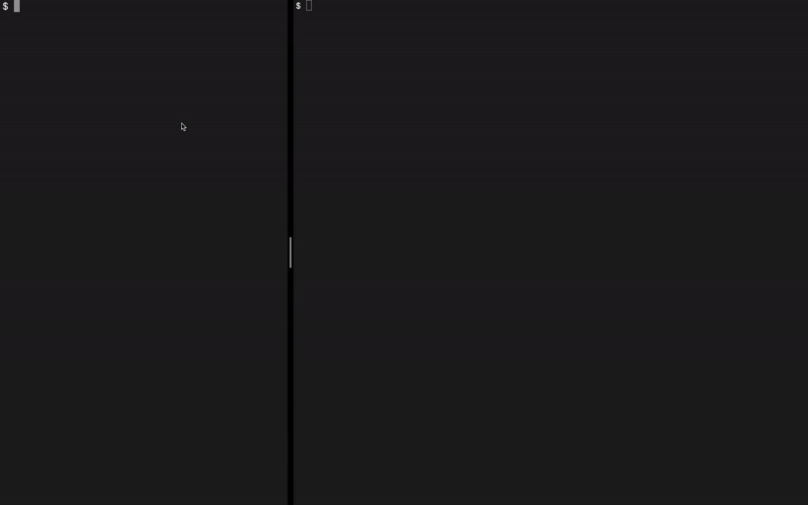
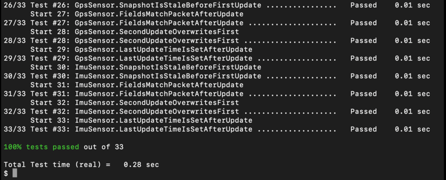

# UAV Real-Time Telemetry Ingestion Engine 🛸

[](https://github.com/sitetester/uav-telemetry-ingester/actions)


A high-performance, low-latency telemetry ingestion pipeline and simulation suite written in modern **C++17/C++20**. This project processes high-frequency sensor payloads from an unmanned aerial vehicle (UAV) over UDP, aggregates states across thread boundaries concurrently, and displays data on a zero-flicker terminal HUD.



## 🏗️ System Architecture

The project is cleanly split into two standalone binaries:
1. **`uav_simulator`**: Simulates live drone physics (altitude, 3-axis IMU orientation, coordinate drift, and battery decay logs) using deterministic random number generators. It pushes packed binary structs over UDP using a fixed-timestep timeline loop to completely eliminate OS clock phase drift.
2. **`uav_telemetry_ingester`**: The core low-latency server. It runs an asynchronous network worker thread that reads raw UDP byte streams, deserializes them safely using non-aliasing `std::memcpy` bitwise copy layers, tracks sensor connection dropouts via hysteresis alerts, and pipes data thread-safely into an in-memory frame buffer.

## 🚀 Getting Started

### 📋 Prerequisites
* A compiler supporting **C++17** or **C++20** (GCC 9+, Clang 10+, or MSVC 2019+)
* **CMake 3.15+**
* Linux or macOS (POSIX network layer native)

---

## 🛠️ Building the Project
From the root project directory, run:

### Step 1: Configure the build tracking workspace
```bash
cmake -S . -B cmake-build-debug -DCMAKE_BUILD_TYPE=Debug
```
* **`-S .`**: Specifies the **Source directory**. This tells CMake where to look for your root configuration file (`CMakeLists.txt`) and your core source code directories.
* **`-B cmake-build-debug`**: Specifies the **Build directory** output folder. This tells CMake to isolate all generated build artifacts, temporary caches, and object files into a dedicated target folder. This is an *out-of-source build*, which keeps your core source directory perfectly clean.
* **`-DCMAKE_BUILD_TYPE=`**: Defines a compilation variable override. Options include:
    * `Debug`: Fast compiling and exact line-by-line debugging.
    * `Release`: Maximum code optimization and execution speed.
    * `RelWithDebInfo`: Production performance balanced with stack tracing symbols.
    * `MinSizeRel`: Smallest executable binary storage footprint.

### Step 2: Compile the actual binary files
```bash
cmake --build cmake-build-debug
```
* **`cmake --build`**: Acts as a unified tool interface that makes your build commands identical across every operating system. It runs your platform-specific builder (like `make` or `ninja`) automatically behind the scenes.
* **`cmake-build-debug`**: Specifies the target folder where your workspace is located. CMake reads the generated configuration profiles here to spin up the compiler, link headers, and output your final executable binaries.

🏎️ Pro Tip: Speed Up Compiles with Multi-Threading
By default, running `cmake --build` compiles your files sequentially using a single CPU core. To leverage all your 
computer's processors and slash your build times down significantly, pass the -j (Jobs) flag followed by the number 
of threads your machine has:

Auto-detects and maximizes all available CPU cores on your hardware
```
cmake --build cmake-build-debug -j
```
---

## 🏃 Running the Application

1. **Start the Drone Simulator:**
   ```bash
   ./cmake-build-debug/uav_simulator
   ```
   *Expected console output:*
   ```text
   UAV Simulator sending to 127.0.0.1:14550
   Press Ctrl+C to stop.
   ```

2. **Launch the Ingestion Server:**
   In a separate terminal window, launch the ingestor engine to read incoming UDP packets:
   ```bash
   ./cmake-build-debug/uav_telemetry_ingester 14550
   ```

*Press `Ctrl+C` in either terminal window to trigger a clean, thread-joined shutdown profile.*

---

## 🧪 Running Tests

To build and execute the automated verification test suite, run the following pipeline:

```bash
cd cmake-build-debug
cmake --build .
ctest --output-on-failure
```
- `cmake --build .` This runs the compiler inside your active directory (represented by the . dot)
- `--output-on-failure` is a crucial diagnostic flag. By default, ctest runs quietly—it only shows a clean Passed or Failed status line. If a unit test fails, this flag forces ctest to print out the exact console log and assertion errors (like a failed network packet length assertion) straight to your screen so you can debug the code immediately.


